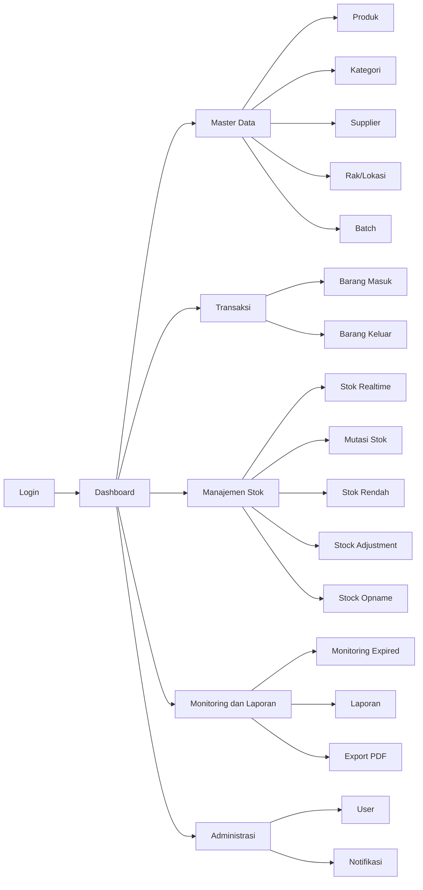

# Skenario Use Case - PSS Warehouse Management System (PSS WMS)

| Atribut | Keterangan |
|---|---|
| Nama Sistem | PSS Warehouse Management System (PSS WMS) |
| Versi Dokumen | 1.0 |
| Tanggal | 17 November 2026 |
| Penyusun | System Analyst |
| Status | Draf untuk validasi pengguna |
| Sumber Acuan | Kode backend (`backend/app/Config/Routes.php`, controller, service, model), skema `database/psswms_db.sql`, dan frontend Vue (`frontend/src`) |
| Ruang Lingkup | Modul yang sudah diimplementasikan pada aplikasi saat ini |

---

## 1. Tujuan dan Ruang Lingkup

Dokumen ini menjelaskan aktor, daftar use case, diagram use case, serta skenario rinci (utama, alternatif, dan pengecualian) dari PSS WMS. Dokumen ditujukan sebagai dasar validasi kebutuhan, pengujian black-box, dan pengembangan lanjutan.

Ruang lingkup dokumen:

1. Autentikasi dan sesi pengguna.
2. Dashboard dan ringkasan operasional gudang.
3. Master data: produk, kategori, supplier, rak/lokasi.
4. Monitoring batch.
5. Transaksi barang masuk (inbound) dan barang keluar (outbound).
6. Manajemen stok: stok realtime, mutasi, stok rendah, stock adjustment.
7. Stock opname.
8. Monitoring barang kedaluwarsa (expired).
9. Laporan dan ekspor PDF.
10. Manajemen pengguna.
11. Notifikasi.

Di luar ruang lingkup dokumen ini:

1. Fitur Purchase Order (PO) dan Delivery Order (DO) yang masih berupa rencana pada `PLAN_PO_DO.md`.
2. Integrasi dengan sistem eksternal (ERP, akuntansi, marketplace).
3. Multi-gudang (multi-warehouse) dan multi-cabang.
4. Pemindaian barcode/QR (tidak ditemukan pada kode saat ini).

---

## 2. Definisi dan Singkatan

| Istilah | Definisi |
|---|---|
| WMS | Warehouse Management System |
| SKU | Stock Keeping Unit, kode unik produk |
| Batch/Lot | Kelompok stok produk dengan nomor batch dan tanggal kedaluwarsa tertentu |
| Inbound | Barang masuk dari supplier ke gudang |
| Outbound | Barang keluar dari gudang ke tujuan pengiriman |
| DRAFT | Status dokumen transaksi yang masih dapat diubah/dihapus |
| COMPLETED | Status dokumen transaksi yang sudah diselesaikan |
| PENDING | Status stock adjustment yang menunggu persetujuan |
| APPROVED | Status stock adjustment yang disetujui dan sudah mengubah stok |
| REJECTED | Status stock adjustment yang ditolak |
| Adjustment | Penyesuaian stok manual atau hasil opname |
| Opname | Penghitungan fisik stok dan pembandingan dengan stok sistem |
| Realtime Stock | Total stok tersedia per produk hasil agregasi seluruh batch |
| Near Expiry | Batch dengan tanggal kedaluwarsa dalam 30 hari ke depan |
| Expired | Batch dengan tanggal kedaluwarsa sebelum hari ini |
| Minimum Stock | Batas minimal stok produk untuk memicu status stok rendah |

---

## 3. Aktor dan Hak Akses

### 3.1 Daftar Aktor

| Aktor | Tipe | Deskripsi |
|---|---|---|
| SUPERADMIN | Primer | Pengguna dengan hak penuh: master data, transaksi, persetujuan adjustment, opname, laporan, manajemen pengguna, dan generate notifikasi |
| ADMIN | Primer | Pengguna administrasi gudang: hak operasional dan persetujuan, termasuk manajemen pengguna dan generate notifikasi |
| GUDANG | Primer | Petugas gudang: transaksi harian, opname, pemantauan stok/expired, dan laporan; tidak dapat mengubah master data, menyetujui adjustment, mengelola pengguna, atau generate notifikasi |
| Sistem | Sekunder | Menghasilkan nomor dokumen otomatis, menghitung stok realtime, menghitung selisih opname, menghitung status expired, dan menyimpan notifikasi |

Catatan: perbedaan SUPERADMIN dan ADMIN pada kode terlihat pada aturan hapus pengguna, yaitu akun sendiri dan SUPERADMIN terakhir tidak boleh dihapus.

### 3.2 Matriks Hak Akses per Modul

Keterangan: L = Lihat, K = Kelola (tambah/ubah/hapus), A = Setujui/Tolak, G = Generate.

| Modul | SUPERADMIN | ADMIN | GUDANG |
|---|---|---|---|
| Login/Logout/Profil | L | L | L |
| Dashboard | L | L | L |
| Produk | L + K | L + K | L |
| Kategori | L + K | L + K | L |
| Supplier | L + K | L + K | L |
| Rak/Lokasi | L + K | L + K | L |
| Batch | L | L | L |
| Barang Masuk | L + K | L + K | L + K |
| Barang Keluar | L + K | L + K | L + K |
| Stok Realtime/Mutasi/Stok Rendah | L | L | L |
| Stock Adjustment (buat) | L + K | L + K | L + K melalui API; tombol UI disembunyikan |
| Stock Adjustment (approve/reject) | A | A | - |
| Stock Opname | L + K | L + K | L + K |
| Monitoring Expired | L | L | L |
| Laporan | L | L | L |
| Export PDF | L | L | L |
| Kelola User | L + K | L + K | - |
| Notifikasi (lihat/tandai) | L | L | L |
| Generate Notifikasi | G | G | - |

Catatan implementasi:

1. Pembatasan menu di frontend menggunakan `v-if="isAdmin"` yang hanya menyembunyikan tombol, bukan mengganti kontrol backend.
2. Kontrol backend untuk operasi master data dan persetujuan adjustment menggunakan `denyIfNotAdmin()`.
3. Modul Barang Masuk, Barang Keluar, dan Stock Opname hanya dilindungi filter `auth` (semua peran yang login dapat mengakses).

---

## 4. Diagram Use Case

### 4.1 Diagram Use Case (PlantUML)

```plantuml
@startuml
left to right direction
skinparam packageStyle rectangle
skinparam actorStyle awesome

actor "SUPERADMIN" as SA
actor "ADMIN" as AD
actor "GUDANG" as GD

rectangle "PSS Warehouse Management System" {
  package "Autentikasi" {
    usecase "UC-01 Login" as UC01
    usecase "UC-02 Logout" as UC02
    usecase "UC-03 Melihat Profil" as UC03
    usecase "UC-04 Melihat Dashboard" as UC04
  }

  package "Master Data" {
    usecase "UC-05 Mengelola Produk" as UC05
    usecase "UC-06 Mengelola Kategori" as UC06
    usecase "UC-07 Mengelola Supplier" as UC07
    usecase "UC-08 Mengelola Rak/Lokasi" as UC08
    usecase "UC-09 Monitoring Batch" as UC09
  }

  package "Transaksi" {
    usecase "UC-10 Mengelola Barang Masuk" as UC10
    usecase "UC-11 Menyelesaikan Barang Masuk" as UC11
    usecase "UC-12 Mengelola Barang Keluar" as UC12
    usecase "UC-13 Menyelesaikan Barang Keluar" as UC13
  }

  package "Manajemen Stok" {
    usecase "UC-14 Melihat Stok Realtime" as UC14
    usecase "UC-15 Melihat Mutasi Stok" as UC15
    usecase "UC-16 Melihat Stok Rendah" as UC16
    usecase "UC-17 Membuat Stock Adjustment" as UC17
    usecase "UC-18 Menyetujui Stock Adjustment" as UC18
    usecase "UC-19 Menolak Stock Adjustment" as UC19
    usecase "UC-20 Membuat Sesi Opname" as UC20
    usecase "UC-21 Mengisi Hasil Opname" as UC21
    usecase "UC-22 Menyelesaikan Sesi Opname" as UC22
    usecase "UC-23 Menghapus Sesi Opname" as UC23
  }

  package "Monitoring dan Laporan" {
    usecase "UC-24 Monitoring Expired" as UC24
    usecase "UC-25 Menampilkan Laporan" as UC25
    usecase "UC-26 Export Laporan PDF" as UC26
  }

  package "Administrasi" {
    usecase "UC-27 Mengelola User" as UC27
    usecase "UC-28 Mengubah Password User" as UC28
    usecase "UC-29 Melihat Notifikasi" as UC29
    usecase "UC-30 Menandai Notifikasi Dibaca" as UC30
    usecase "UC-31 Generate Notifikasi" as UC31
  }
}

SA --> UC01
AD --> UC01
GD --> UC01

SA --> UC02
AD --> UC02
GD --> UC02

SA --> UC03
AD --> UC03
GD --> UC03

SA --> UC04
AD --> UC04
GD --> UC04

SA --> UC05
AD --> UC05
GD --> UC05

SA --> UC06
AD --> UC06
GD --> UC06

SA --> UC07
AD --> UC07
GD --> UC07

SA --> UC08
AD --> UC08
GD --> UC08

SA --> UC09
AD --> UC09
GD --> UC09

SA --> UC10
AD --> UC10
GD --> UC10

SA --> UC11
AD --> UC11
GD --> UC11

SA --> UC12
AD --> UC12
GD --> UC12

SA --> UC13
AD --> UC13
GD --> UC13

SA --> UC14
AD --> UC14
GD --> UC14

SA --> UC15
AD --> UC15
GD --> UC15

SA --> UC16
AD --> UC16
GD --> UC16

SA --> UC17
AD --> UC17
GD --> UC17

SA --> UC18
AD --> UC18

SA --> UC19
AD --> UC19

SA --> UC20
AD --> UC20
GD --> UC20

SA --> UC21
AD --> UC21
GD --> UC21

SA --> UC22
AD --> UC22
GD --> UC22

SA --> UC23
AD --> UC23
GD --> UC23

SA --> UC24
AD --> UC24
GD --> UC24

SA --> UC25
AD --> UC25
GD --> UC25

SA --> UC26
AD --> UC26
GD --> UC26

SA --> UC27
AD --> UC27

SA --> UC28
AD --> UC28

SA --> UC29
AD --> UC29
GD --> UC29

SA --> UC30
AD --> UC30
GD --> UC30

SA --> UC31
AD --> UC31

note right of GD
  GUDANG hanya memiliki akses lihat
  pada UC-05 sampai UC-09 dan
  tidak memiliki akses UC-18, UC-19,
  UC-27, UC-28, dan UC-31.
end note

@enduml
```

### 4.2 Peta Modul (Mermaid)

---

## 5. Ringkasan Use Case

| ID | Use Case | Aktor Utama | Modul | Prioritas |
|---|---|---|---|---|
| UC-01 | Login | SUPERADMIN, ADMIN, GUDANG | Autentikasi | Tinggi |
| UC-02 | Logout | SUPERADMIN, ADMIN, GUDANG | Autentikasi | Tinggi |
| UC-03 | Melihat Profil Sendiri | SUPERADMIN, ADMIN, GUDANG | Autentikasi | Rendah |
| UC-04 | Melihat Dashboard | SUPERADMIN, ADMIN, GUDANG | Dashboard | Tinggi |
| UC-05 | Mengelola Produk | SUPERADMIN, ADMIN | Master Data | Tinggi |
| UC-06 | Mengelola Kategori | SUPERADMIN, ADMIN | Master Data | Tinggi |
| UC-07 | Mengelola Supplier | SUPERADMIN, ADMIN | Master Data | Tinggi |
| UC-08 | Mengelola Rak/Lokasi | SUPERADMIN, ADMIN | Master Data | Sedang |
| UC-09 | Monitoring Batch | SUPERADMIN, ADMIN, GUDANG | Master Data | Sedang |
| UC-10 | Mengelola Barang Masuk | SUPERADMIN, ADMIN, GUDANG | Transaksi | Tinggi |
| UC-11 | Menyelesaikan Barang Masuk | SUPERADMIN, ADMIN, GUDANG | Transaksi | Tinggi |
| UC-12 | Mengelola Barang Keluar | SUPERADMIN, ADMIN, GUDANG | Transaksi | Tinggi |
| UC-13 | Menyelesaikan Barang Keluar | SUPERADMIN, ADMIN, GUDANG | Transaksi | Tinggi |
| UC-14 | Melihat Stok Realtime | SUPERADMIN, ADMIN, GUDANG | Manajemen Stok | Tinggi |
| UC-15 | Melihat Mutasi Stok | SUPERADMIN, ADMIN, GUDANG | Manajemen Stok | Sedang |
| UC-16 | Melihat Stok Rendah | SUPERADMIN, ADMIN, GUDANG | Manajemen Stok | Tinggi |
| UC-17 | Membuat Stock Adjustment | SUPERADMIN, ADMIN | Manajemen Stok | Tinggi |
| UC-18 | Menyetujui Stock Adjustment | SUPERADMIN, ADMIN | Manajemen Stok | Tinggi |
| UC-19 | Menolak Stock Adjustment | SUPERADMIN, ADMIN | Manajemen Stok | Sedang |
| UC-20 | Membuat Sesi Opname | SUPERADMIN, ADMIN, GUDANG | Manajemen Stok | Tinggi |
| UC-21 | Mengisi Hasil Opname | SUPERADMIN, ADMIN, GUDANG | Manajemen Stok | Tinggi |
| UC-22 | Menyelesaikan Sesi Opname | SUPERADMIN, ADMIN, GUDANG | Manajemen Stok | Tinggi |
| UC-23 | Menghapus Sesi Opname | SUPERADMIN, ADMIN, GUDANG | Manajemen Stok | Rendah |
| UC-24 | Monitoring Expired | SUPERADMIN, ADMIN, GUDANG | Monitoring | Tinggi |
| UC-25 | Menampilkan Laporan | SUPERADMIN, ADMIN, GUDANG | Laporan | Tinggi |
| UC-26 | Export Laporan PDF | SUPERADMIN, ADMIN, GUDANG | Laporan | Sedang |
| UC-27 | Mengelola User | SUPERADMIN, ADMIN | Administrasi | Sedang |
| UC-28 | Mengubah Password User | SUPERADMIN, ADMIN | Administrasi | Sedang |
| UC-29 | Melihat Notifikasi | SUPERADMIN, ADMIN, GUDANG | Administrasi | Rendah |
| UC-30 | Menandai Notifikasi Dibaca | SUPERADMIN, ADMIN, GUDANG | Administrasi | Rendah |
| UC-31 | Generate Notifikasi | SUPERADMIN, ADMIN | Administrasi | Sedang |

---

## 6. Skenario Use Case

Format setiap use case: aktor, tujuan, pra-kondisi, pemicu, skenario utama, skenario alternatif, skenario pengecualian, pasca-kondisi, dan endpoint terkait.

### UC-01 Login

| Atribut | Keterangan |
|---|---|
| Aktor | SUPERADMIN, ADMIN, GUDANG |
| Tujuan | Memperoleh sesi terautentikasi untuk mengakses aplikasi |
| Pra-kondisi | Pengguna belum login atau sesi sudah berakhir |
| Pemicu | Pengguna membuka aplikasi atau mengakses halaman yang dilindungi |
| Endpoint | `POST /api/login` |
| Halaman | `Login.vue` |

**Skenario Utama**

1. Sistem menampilkan form login berisi username dan password.
2. Pengguna mengisi username dan password lalu menekan tombol Login.
3. Frontend mengirim permintaan `POST /api/login`.
4. Sistem memvalidasi bahwa username dan password tidak kosong.
5. Sistem mencari pengguna berdasarkan username.
6. Sistem memverifikasi password menggunakan `password_verify`.
7. Sistem memeriksa status pengguna harus `AKTIF`.
8. Sistem meregenerasi sesi dan menyimpan `logged_in`, `id_user`, `name`, `username`, dan `role`.
9. Sistem mengembalikan respons berhasil berisi data pengguna.
10. Frontend menyimpan data peran dan mengarahkan pengguna ke dashboard.

**Skenario Alternatif**

- A1. Username atau password kosong: sistem menolak dan menampilkan pesan "Username dan Password wajib diisi".
- A2. Pengguna sudah memiliki sesi aktif dan membuka halaman login: pengguna diarahkan ke dashboard.

**Skenario Pengecualian**

- E1. Username tidak ditemukan atau password salah: sistem mengembalikan HTTP 401 dengan pesan "Username atau password salah".
- E2. Status pengguna bukan `AKTIF`: sistem mengembalikan pesan "Akun sudah dinonaktifkan. Silakan hubungi administrator.".
- E3. Terjadi kesalahan server: sistem mengembalikan HTTP 500 dan pengguna tetap pada halaman login.

**Pasca-kondisi**

- Sesi login aktif dan pengguna dapat mengakses menu sesuai perannya.

---

### UC-02 Logout

| Atribut | Keterangan |
|---|---|
| Aktor | SUPERADMIN, ADMIN, GUDANG |
| Tujuan | Mengakhiri sesi dan keluar dari aplikasi |
| Pra-kondisi | Pengguna dalam keadaan login |
| Pemicu | Pengguna menekan tombol Logout |
| Endpoint | `POST /api/logout` |
| Halaman | Navbar |

**Skenario Utama**

1. Pengguna menekan tombol Logout.
2. Frontend mengirim permintaan `POST /api/logout`.
3. Sistem menghancurkan data sesi.
4. Sistem mengembalikan respons "Logout berhasil".
5. Frontend menghapus data sesi lokal dan mengarahkan pengguna ke halaman login.

**Skenario Alternatif**

- A1. Pengguna menutup browser tanpa logout: sesi berakhir sesuai konfigurasi server.

**Skenario Pengecualian**

- E1. Sesi sudah tidak valid: sistem mengembalikan HTTP 401, frontend menampilkan "Sesi Berakhir" dan mengarahkan ke login.
- E2. Terjadi kesalahan server: frontend menampilkan pesan gagal logout.

**Pasca-kondisi**

- Sesi pengguna berakhir dan halaman terproteksi tidak dapat diakses.

---

### UC-03 Melihat Profil Sendiri

| Atribut | Keterangan |
|---|---|
| Aktor | SUPERADMIN, ADMIN, GUDANG |
| Tujuan | Menampilkan identitas pengguna yang sedang login |
| Pra-kondisi | Pengguna sudah login |
| Pemicu | Halaman dimuat atau Navbar membaca data pengguna |
| Endpoint | `GET /api/me` |
| Halaman | Navbar |

**Skenario Utama**

1. Frontend meminta data pengguna aktif ke `GET /api/me`.
2. Sistem membaca data dari sesi.
3. Sistem mengembalikan nama, username, dan peran pengguna.
4. Frontend menampilkan nama dan peran pada Navbar.

**Skenario Alternatif**

- A1. Data sesi tidak lengkap: frontend menampilkan nilai default dan tetap mengizinkan logout.

**Skenario Pengecualian**

- E1. Sesi berakhir: sistem mengembalikan HTTP 401 dan pengguna diarahkan ke login.

**Pasca-kondisi**

- Informasi pengguna tampil pada antarmuka.

---

### UC-04 Melihat Dashboard

| Atribut | Keterangan |
|---|---|
| Aktor | SUPERADMIN, ADMIN, GUDANG |
| Tujuan | Menampilkan ringkasan kondisi gudang |
| Pra-kondisi | Pengguna sudah login |
| Pemicu | Pengguna membuka menu Dashboard |
| Endpoint | `GET /api/dashboard/summary`, `GET /api/dashboard/chart`, `GET /api/dashboard/top-outbound`, `GET /api/dashboard/expired-products` |
| Halaman | `Dashboard.vue` |

**Skenario Utama**

1. Pengguna membuka menu Dashboard.
2. Frontend meminta data ringkasan, grafik, produk keluar terbanyak, dan produk mendekati expired.
3. Sistem menghitung total produk aktif, total batch, total stok, jumlah stok rendah, jumlah produk mendekati expired 30 hari, serta transaksi masuk dan keluar hari ini.
4. Sistem menyusun data grafik tren barang masuk dan keluar.
5. Sistem menyusun daftar produk dengan total outbound tertinggi dan daftar produk mendekati expired.
6. Frontend menampilkan kartu ringkasan, grafik, dan tabel.

**Skenario Alternatif**

- A1. Belum ada data transaksi: sistem mengembalikan nilai nol atau daftar kosong dan dashboard tetap tampil.
- A2. Sebagian endpoint gagal: frontend menampilkan komponen yang berhasil dan mengosongkan komponen yang gagal.

**Skenario Pengecualian**

- E1. Sesi berakhir: HTTP 401 dan pengguna diarahkan ke login.
- E2. Kesalahan server: HTTP 500 dan dashboard menampilkan kondisi kosong.

**Pasca-kondisi**

- Ringkasan kondisi gudang terbaru ditampilkan.

---

### UC-05 Mengelola Produk

| Atribut | Keterangan |
|---|---|
| Aktor | SUPERADMIN, ADMIN (kelola); GUDANG (lihat) |
| Tujuan | Menampilkan dan memelihara data produk |
| Pra-kondisi | Pengguna sudah login; untuk tambah/ubah/hapus harus ADMIN atau SUPERADMIN |
| Pemicu | Pengguna membuka menu Produk atau menekan tombol tambah/edit/hapus |
| Endpoint | `GET /api/products`, `GET /api/products/statistic`, `GET /api/products/{id}`, `POST /api/products`, `PUT /api/products/{id}`, `DELETE /api/products/{id}` |
| Halaman | `Produk.vue` |

**Skenario Utama - Melihat Produk**

1. Pengguna membuka menu Produk.
2. Frontend meminta daftar produk beserta statistik.
3. Sistem mengembalikan data produk (SKU, nama, kategori, supplier, satuan, stok minimum, status) dan statistik.
4. Pengguna dapat mencari, memfilter, dan berpindah halaman.
5. Frontend menampilkan daftar produk.

**Skenario Utama - Menambah Produk**

1. ADMIN/SUPERADMIN menekan tombol Tambah Produk.
2. Sistem menampilkan formulir produk.
3. Pengguna mengisi nama, SKU, kategori, supplier, merek, satuan, stok minimum, dan status.
4. Pengguna menekan Simpan.
5. Frontend mengirim `POST /api/products`.
6. Sistem memvalidasi kolom wajib: nama, SKU, kategori, dan supplier.
7. Sistem memeriksa keunikan SKU.
8. Sistem menyimpan produk dan mengembalikan pesan "Produk berhasil ditambahkan".
9. Frontend menampilkan notifikasi berhasil dan memuat ulang daftar.

**Skenario Utama - Mengubah Produk**

1. ADMIN/SUPERADMIN menekan tombol Edit pada salah satu produk.
2. Sistem menampilkan formulir berisi data produk.
3. Pengguna mengubah data lalu menekan Update.
4. Frontend mengirim `PUT /api/products/{id}`.
5. Sistem memeriksa keberadaan produk dan keunikan SKU terhadap produk lain.
6. Sistem menyimpan perubahan dan mengembalikan pesan "Produk berhasil diupdate".

**Skenario Utama - Menghapus Produk**

1. ADMIN/SUPERADMIN menekan tombol Hapus.
2. Sistem menampilkan konfirmasi penghapusan.
3. Pengguna mengonfirmasi.
4. Frontend mengirim `DELETE /api/products/{id}`.
5. Sistem memeriksa apakah produk masih memiliki batch stok.
6. Jika tidak ada batch, sistem menghapus produk dan mengembalikan pesan "Produk berhasil dihapus".

**Skenario Alternatif**

- A1. Pencarian atau filter tidak menemukan data: sistem menampilkan daftar kosong.
- A2. Produk masih memiliki batch: sistem menolak penghapusan dan menyarankan menonaktifkan produk.
- A3. Tidak ada perubahan data saat update: sistem mengembalikan pesan "Tidak ada perubahan pada produk".

**Skenario Pengecualian**

- E1. Kolom wajib tidak diisi: sistem mengembalikan pesan "Field {nama field} wajib diisi".
- E2. SKU sudah digunakan: sistem mengembalikan pesan "SKU code sudah digunakan".
- E3. Produk tidak ditemukan saat ubah/hapus: HTTP 404 "Produk tidak ditemukan".
- E4. Produk masih memiliki batch: pesan "Produk tidak bisa dihapus karena masih memiliki batch stok. Nonaktifkan produk saja.".
- E5. Pengguna GUDANG mencoba menambah/ubah/hapus: HTTP 403 "Forbidden. Hanya ADMIN dan SUPERADMIN yang dapat melakukan operasi ini.".

**Pasca-kondisi**

- Data produk tersimpan, berubah, atau terhapus sesuai aksi.
- Penghapusan produk hanya berhasil bila tidak memiliki batch.

---

### UC-06 Mengelola Kategori

| Atribut | Keterangan |
|---|---|
| Aktor | SUPERADMIN, ADMIN (kelola); GUDANG (lihat) |
| Tujuan | Menampilkan dan memelihara data kategori produk |
| Pra-kondisi | Pengguna sudah login; untuk tambah/ubah/hapus harus ADMIN atau SUPERADMIN |
| Pemicu | Pengguna membuka menu Kategori atau menekan tombol tambah/edit/hapus |
| Endpoint | `GET /api/categories`, `GET /api/categories/all`, `GET /api/categories/next-code`, `GET /api/categories/{id}`, `POST /api/categories`, `PUT /api/categories/{id}`, `DELETE /api/categories/{id}` |
| Halaman | `Kategori.vue` |

**Skenario Utama - Melihat Kategori**

1. Pengguna membuka menu Kategori.
2. Frontend meminta daftar kategori dengan parameter halaman, batas, pencarian, status, dan pengurutan.
3. Sistem memvalidasi batas maksimal 100 data per halaman.
4. Sistem mengembalikan data kategori beserta jumlah produk per kategori.
5. Frontend menampilkan daftar kategori.

**Skenario Utama - Menambah Kategori**

1. ADMIN/SUPERADMIN menekan tombol Tambah Kategori.
2. Sistem meminta kode kategori berikutnya melalui `GET /api/categories/next-code`.
3. Pengguna mengisi nama dan kode kategori.
4. Frontend mengirim `POST /api/categories`.
5. Sistem memvalidasi nama wajib diisi, maksimal 200 karakter, serta keunikan nama dan kode.
6. Sistem menyimpan kategori dan mengembalikan pesan "Kategori berhasil ditambahkan".

**Skenario Utama - Mengubah Kategori**

1. ADMIN/SUPERADMIN menekan tombol Edit.
2. Pengguna mengubah data dan menekan Update.
3. Frontend mengirim `PUT /api/categories/{id}`.
4. Sistem memvalidasi data dan keunikan nama/kode.
5. Sistem menyimpan perubahan dan mengembalikan pesan "Kategori berhasil diupdate".

**Skenario Utama - Menghapus Kategori**

1. ADMIN/SUPERADMIN menekan tombol Hapus dan mengonfirmasi.
2. Frontend mengirim `DELETE /api/categories/{id}`.
3. Sistem menghitung jumlah produk yang menggunakan kategori.
4. Jika tidak digunakan, sistem menghapus kategori dan mengembalikan pesan "Kategori berhasil dihapus".

**Skenario Alternatif**

- A1. Kode kategori kosong: sistem menghasilkan kode berikutnya secara otomatis.
- A2. Kategori masih digunakan produk: sistem menolak penghapusan dan menyarankan menonaktifkan kategori.

**Skenario Pengecualian**

- E1. Nama kosong: "Nama kategori wajib diisi".
- E2. Nama lebih dari 200 karakter: "Nama kategori maksimal 200 karakter".
- E3. Nama sudah dipakai: HTTP 409 "Nama kategori sudah digunakan".
- E4. Kode sudah dipakai: HTTP 409 "Kode kategori sudah digunakan".
- E5. Kategori tidak ditemukan: HTTP 404 "Kategori tidak ditemukan".
- E6. Kategori dipakai produk: HTTP 409 "Kategori tidak bisa dihapus karena sedang digunakan oleh {jumlah} produk. Nonaktifkan kategori saja.".
- E7. Pengguna GUDANG mencoba mengubah data: HTTP 403.

**Pasca-kondisi**

- Data kategori tersimpan, berubah, atau terhapus sesuai aksi.

---

### UC-07 Mengelola Supplier

| Atribut | Keterangan |
|---|---|
| Aktor | SUPERADMIN, ADMIN (kelola); GUDANG (lihat) |
| Tujuan | Menampilkan dan memelihara data supplier |
| Pra-kondisi | Pengguna sudah login; untuk tambah/ubah/hapus harus ADMIN atau SUPERADMIN |
| Pemicu | Pengguna membuka menu Supplier atau menekan tombol tambah/edit/hapus |
| Endpoint | `GET /api/suppliers`, `GET /api/suppliers/{id}`, `POST /api/suppliers`, `PUT /api/suppliers/{id}`, `DELETE /api/suppliers/{id}` |
| Halaman | `Supplier.vue` |

**Skenario Utama - Menambah Supplier**

1. ADMIN/SUPERADMIN menekan tombol Tambah Supplier.
2. Pengguna mengisi kode supplier, nama, alamat, telepon, email, dan status.
3. Frontend mengirim `POST /api/suppliers`.
4. Sistem memvalidasi kode dan nama wajib diisi, format email, serta keunikan kode supplier.
5. Sistem menghasilkan ID supplier berformat `SUP-######`.
6. Sistem menyimpan supplier dan mengembalikan pesan "Supplier berhasil ditambahkan".

**Skenario Utama - Mengubah Supplier**

1. ADMIN/SUPERADMIN menekan tombol Edit.
2. Pengguna mengubah data lalu menekan Update.
3. Frontend mengirim `PUT /api/suppliers/{id}`.
4. Sistem memvalidasi data dan keunikan kode.
5. Sistem menyimpan perubahan dan mengembalikan pesan "Supplier berhasil diupdate".

**Skenario Utama - Menghapus Supplier**

1. ADMIN/SUPERADMIN menekan tombol Hapus dan mengonfirmasi.
2. Frontend mengirim `DELETE /api/suppliers/{id}`.
3. Sistem memeriksa apakah supplier masih memiliki transaksi inbound.
4. Jika tidak ada, sistem menghapus supplier dan mengembalikan pesan "Supplier berhasil dihapus".

**Skenario Alternatif**

- A1. Pencarian supplier tidak menemukan data: daftar kosong ditampilkan.
- A2. Supplier masih memiliki transaksi inbound: sistem menolak penghapusan dan menyarankan menonaktifkan supplier.

**Skenario Pengecualian**

- E1. Kode atau nama kosong: "Field supplier_code dan name wajib diisi".
- E2. Format email tidak valid: "Format email tidak valid".
- E3. Kode sudah dipakai: HTTP 409 "Kode supplier sudah digunakan".
- E4. Supplier tidak ditemukan: HTTP 404 "Supplier tidak ditemukan".
- E5. Supplier memiliki transaksi inbound: HTTP 409 "Supplier tidak bisa dihapus karena masih memiliki transaksi inbound. Nonaktifkan saja.".
- E6. Request update bukan JSON valid: "Data request tidak valid. Pastikan mengirimkan JSON.".
- E7. Pengguna GUDANG mencoba mengubah data: HTTP 403.

**Pasca-kondisi**

- Data supplier tersimpan, berubah, atau terhapus sesuai aksi.

---

### UC-08 Mengelola Rak/Lokasi

| Atribut | Keterangan |
|---|---|
| Aktor | SUPERADMIN, ADMIN (kelola); GUDANG (lihat) |
| Tujuan | Menampilkan dan memelihara data rak penyimpanan |
| Pra-kondisi | Pengguna sudah login; untuk tambah/ubah/hapus harus ADMIN atau SUPERADMIN |
| Pemicu | Pengguna membuka menu Rak atau menekan tombol tambah/edit/hapus |
| Endpoint | `GET /api/rack`, `GET /api/rack/{id}`, `POST /api/rack`, `PUT /api/rack/{id}`, `DELETE /api/rack/{id}` |
| Halaman | `RakLokasi.vue` |

**Skenario Utama - Menambah Rak**

1. ADMIN/SUPERADMIN menekan tombol Tambah Rak.
2. Pengguna mengisi kode rak, nama, dan kode rak bagian atas (shelf).
3. Frontend mengirim `POST /api/rack`.
4. Sistem memvalidasi kode rak wajib diisi, maksimal 50 karakter, nama maksimal 100 karakter, dan keunikan kode.
5. Sistem menyimpan rak dan mengembalikan pesan "Rak berhasil ditambahkan".

**Skenario Utama - Mengubah Rak**

1. ADMIN/SUPERADMIN menekan tombol Edit.
2. Pengguna mengubah data dan menekan Update.
3. Frontend mengirim `PUT /api/rack/{id}`.
4. Sistem memvalidasi data dan keunikan kode.
5. Sistem menyimpan perubahan dan mengembalikan pesan "Rak berhasil diupdate".

**Skenario Utama - Menghapus Rak**

1. ADMIN/SUPERADMIN menekan tombol Hapus dan mengonfirmasi.
2. Frontend mengirim `DELETE /api/rack/{id}`.
3. Sistem menghitung jumlah batch yang menggunakan rak.
4. Jika tidak digunakan, sistem menghapus rak dan mengembalikan pesan "Rak berhasil dihapus".

**Skenario Alternatif**

- A1. Rak masih digunakan batch: sistem menolak penghapusan dan menyarankan menonaktifkan rak.

**Skenario Pengecualian**

- E1. Kode rak kosong: "Kode rak wajib diisi".
- E2. Kode lebih dari 50 karakter: "Kode rak maksimal 50 karakter".
- E3. Nama lebih dari 100 karakter: "Nama rak maksimal 100 karakter".
- E4. Kode sudah dipakai: HTTP 409 "Kode rak sudah digunakan".
- E5. Rak tidak ditemukan: HTTP 404 "Rak tidak ditemukan".
- E6. Rak dipakai batch: HTTP 409 "Rak tidak bisa dihapus karena sedang digunakan oleh {jumlah} batch produk. Nonaktifkan rak saja.".
- E7. Pengguna GUDANG mencoba mengubah data: HTTP 403.

**Pasca-kondisi**

- Data rak tersimpan, berubah, atau terhapus sesuai aksi.

---

### UC-09 Monitoring Batch

| Atribut | Keterangan |
|---|---|
| Aktor | SUPERADMIN, ADMIN, GUDANG |
| Tujuan | Memantau batch stok beserta sisa umur simpan |
| Pra-kondisi | Pengguna sudah login |
| Pemicu | Pengguna membuka menu Batch |
| Endpoint | `GET /api/batches`, `GET /api/batches/statistic`, `GET /api/batches/{id}` |
| Halaman | `Batch.vue` |

**Skenario Utama**

1. Pengguna membuka menu Batch.
2. Frontend meminta daftar batch dan statistik.
3. Sistem mengembalikan data batch beserta nama produk, rak, dan sisa hari menuju kedaluwarsa.
4. Frontend menampilkan daftar batch dan ringkasan statistik.
5. Pengguna dapat mencari dan memfilter data.

**Skenario Alternatif**

- A1. Tidak ada batch: daftar kosong ditampilkan.
- A2. Batch tidak memiliki rak: kolom rak menampilkan tanda "-".

**Skenario Pengecualian**

- E1. Batch tidak ditemukan saat membuka detail: HTTP 404 "Batch tidak ditemukan".
- E2. Kesalahan server: HTTP 500 "Gagal memuat data batch".

**Pasca-kondisi**

- Informasi batch dan sisa umur simpan ditampilkan.

**Catatan**

- Batch dibuat secara otomatis saat barang masuk diselesaikan.
- Endpoint tambah/ubah/hapus batch tidak dibuka pada `Routes.php`; halaman Batch bersifat monitoring (read-only). Method tulis pada controller ada tetapi tidak terdaftar sebagai route.

---

### UC-10 Mengelola Barang Masuk

| Atribut | Keterangan |
|---|---|
| Aktor | SUPERADMIN, ADMIN, GUDANG |
| Tujuan | Mencatat rencana dan detail penerimaan barang dari supplier |
| Pra-kondisi | Pengguna sudah login; supplier, produk, dan rak tersedia |
| Pemicu | Pengguna membuka menu Barang Masuk atau menekan tombol Tambah/Edit/Hapus |
| Endpoint | `GET /api/inbound`, `GET /api/inbound/{id}`, `GET /api/inbound/products-by-supplier/{id_supplier}`, `POST /api/inbound`, `PUT /api/inbound/{id}`, `DELETE /api/inbound/{id}` |
| Halaman | `BarangMasuk.vue` |

**Skenario Utama - Melihat Daftar**

1. Pengguna membuka menu Barang Masuk.
2. Sistem menampilkan daftar penerimaan beserta nomor, supplier, tanggal, status, dan statistik (hari ini, draft, selesai).

**Skenario Utama - Menambah Barang Masuk**

1. Pengguna menekan tombol Tambah.
2. Sistem menampilkan formulir penerimaan.
3. Pengguna memilih supplier.
4. Sistem memuat produk milik supplier melalui `GET /api/inbound/products-by-supplier/{id_supplier}`.
5. Pengguna mengisi nomor penerimaan (opsional), tanggal penerimaan (default hari ini), dan catatan.
6. Pengguna menambahkan satu atau lebih baris detail berisi produk, nomor batch/lot, quantity, tanggal expired, dan rak.
7. Frontend memvalidasi supplier, tanggal, minimal satu detail, produk, batch, quantity minimal 1, dan tanggal expired.
8. Frontend mengirim `POST /api/inbound`.
9. Sistem memvalidasi tanggal penerimaan, supplier, dan detail barang.
10. Sistem memvalidasi setiap baris: produk wajib dipilih, quantity lebih dari 0, dan produk harus ada.
11. Sistem memeriksa supplier aktif.
12. Sistem menghasilkan nomor penerimaan `INB-######` bila nomor tidak diisi.
13. Sistem menyimpan header dan detail dengan status `DRAFT` dalam satu transaksi.
14. Sistem mengembalikan pesan "Inbound berhasil dibuat".

**Skenario Utama - Mengubah Barang Masuk**

1. Pengguna menekan tombol Edit pada data berstatus `DRAFT`.
2. Pengguna mengubah header atau detail lalu menekan Update.
3. Frontend mengirim `PUT /api/inbound/{id}`.
4. Sistem memastikan data ada dan berstatus `DRAFT`.
5. Sistem memperbarui header dan mengganti detail.
6. Sistem mengembalikan pesan "Inbound berhasil diupdate".

**Skenario Utama - Menghapus Barang Masuk**

1. Pengguna menekan tombol Hapus pada data `DRAFT` dan mengonfirmasi.
2. Frontend mengirim `DELETE /api/inbound/{id}`.
3. Sistem memastikan data ada dan berstatus `DRAFT`.
4. Sistem menghapus header dan detail.
5. Sistem mengembalikan pesan "Inbound berhasil dihapus".

**Skenario Alternatif**

- A1. Nomor penerimaan dikosongkan: sistem membuat nomor otomatis.
- A2. Data berstatus `COMPLETED`: tombol Edit dan Hapus tidak ditampilkan.
- A3. Pengguna mengganti supplier: daftar produk pada detail direset.

**Skenario Pengecualian**

- E1. Tanggal penerimaan kosong: "Tanggal penerimaan wajib diisi".
- E2. Supplier belum dipilih: "Supplier wajib dipilih".
- E3. Detail kosong: "Detail barang wajib diisi".
- E4. Supplier tidak ada atau tidak aktif: "Supplier tidak ditemukan atau tidak aktif".
- E5. Produk belum dipilih: "Baris {n}: Produk wajib dipilih".
- E6. Quantity tidak valid: "Baris {n}: Quantity harus lebih dari 0".
- E7. Produk tidak ditemukan: "Baris {n}: Produk tidak ditemukan".
- E8. Data tidak ditemukan: "Inbound tidak ditemukan".
- E9. Status bukan `DRAFT`: "Hanya inbound dengan status DRAFT yang bisa diubah" atau "...yang bisa dihapus".
- E10. Validasi frontend gagal: pesan SweetAlert "Validasi" ditampilkan dan data tidak dikirim.

**Pasca-kondisi**

- Dokumen inbound tersimpan sebagai `DRAFT`, berubah, atau terhapus.
- Stok belum berubah sampai UC-11 dijalankan.

---

### UC-11 Menyelesaikan Barang Masuk

| Atribut | Keterangan |
|---|---|
| Aktor | SUPERADMIN, ADMIN, GUDANG |
| Tujuan | Menambahkan stok ke batch dan menutup dokumen penerimaan |
| Pra-kondisi | Dokumen inbound berstatus `DRAFT` dan memiliki detail |
| Pemicu | Pengguna menekan tombol Selesai pada dokumen inbound |
| Endpoint | `POST /api/inbound/{id}/complete` |
| Halaman | `BarangMasuk.vue` |

**Skenario Utama**

1. Pengguna menekan tombol Selesai pada data `DRAFT`.
2. Sistem menampilkan konfirmasi.
3. Pengguna mengonfirmasi.
4. Frontend mengirim `POST /api/inbound/{id}/complete`.
5. Sistem mengunci header dan memastikan status masih `DRAFT`.
6. Sistem mengambil seluruh detail dan memastikan tidak kosong.
7. Untuk setiap baris, sistem memvalidasi nomor batch wajib diisi, quantity lebih dari 0, dan produk harus milik supplier pada header.
8. Sistem mencari batch yang sudah ada berdasarkan produk dan nomor batch.
9. Jika batch sudah ada, sistem memastikan tanggal expired dan rak konsisten, lalu menambah quantity batch.
10. Jika batch belum ada, sistem membuat batch baru berisi produk, nomor batch, tanggal expired, quantity, dan rak.
11. Sistem menyimpan ID batch pada detail inbound.
12. Sistem mengubah status header menjadi `COMPLETED`.
13. Sistem mengembalikan pesan "Inbound berhasil diselesaikan dan stok telah ditambahkan".

**Skenario Alternatif**

- A1. Batch dengan nomor sama sudah ada dan tanggal expired/rak sama: quantity ditambahkan ke batch tersebut.
- A2. Tanggal expired pada detail kosong: batch baru disimpan tanpa tanggal expired.

**Skenario Pengecualian**

- E1. Dokumen tidak ditemukan: "Inbound tidak ditemukan".
- E2. Status bukan `DRAFT`: "Hanya inbound dengan status DRAFT yang bisa diselesaikan".
- E3. Tidak ada detail: "Tidak ada detail barang untuk inbound ini".
- E4. Nomor batch kosong: "Baris {n}: Batch/Lot wajib diisi sebelum menyelesaikan inbound".
- E5. Quantity tidak valid: "Baris {n}: Quantity harus lebih dari 0".
- E6. Produk bukan milik supplier: "Baris {n}: Produk "{nama}" tidak sesuai dengan supplier "{supplier}"".
- E7. Tanggal expired berbeda dengan batch yang ada: pesan ketidakcocokan tanggal expired.
- E8. Rak berbeda dengan batch yang ada: "Baris {n}: Rak tidak cocok dengan batch "{nomor}" yang sudah ada".
- E9. Kesalahan basis data: transaksi dibatalkan dan pesan "Gagal menyelesaikan inbound: ...".

**Pasca-kondisi**

- Stok bertambah pada batch terkait.
- Dokumen inbound menjadi `COMPLETED` dan tidak dapat diubah/dihapus.
- Notifikasi penyelesaian inbound tidak dibuat otomatis (lihat Bagian 9).

---

### UC-12 Mengelola Barang Keluar

| Atribut | Keterangan |
|---|---|
| Aktor | SUPERADMIN, ADMIN, GUDANG |
| Tujuan | Mencatat rencana dan detail pengeluaran barang dari gudang |
| Pra-kondisi | Pengguna sudah login; produk dan batch dengan stok tersedia |
| Pemicu | Pengguna membuka menu Barang Keluar atau menekan tombol Tambah/Edit/Hapus |
| Endpoint | `GET /api/outbound`, `GET /api/outbound/{id}`, `POST /api/outbound`, `PUT /api/outbound/{id}`, `DELETE /api/outbound/{id}` |
| Halaman | `BarangKeluar.vue` |

**Skenario Utama - Melihat Daftar**

1. Pengguna membuka menu Barang Keluar.
2. Sistem menampilkan daftar pengeluaran beserta nomor, tanggal, status, dan statistik (hari ini, draft, selesai).

**Skenario Utama - Menambah Barang Keluar**

1. Pengguna menekan tombol Tambah.
2. Sistem menampilkan formulir pengeluaran.
3. Pengguna mengisi nomor pengiriman (opsional), tanggal pengiriman, dan catatan.
4. Pengguna menambahkan baris detail: pilih produk, lalu pilih batch yang memiliki stok lebih dari 0, dan isi quantity.
5. Frontend membatasi quantity maksimal sesuai stok batch.
6. Frontend mengirim `POST /api/outbound`.
7. Sistem memvalidasi tanggal pengiriman dan detail barang.
8. Sistem memvalidasi setiap batch harus ada dan quantity lebih dari 0.
9. Sistem memastikan stok batch mencukupi.
10. Sistem mengurangi quantity batch dan menyimpan header `DRAFT` beserta detail dalam satu transaksi.
11. Sistem menghasilkan nomor pengiriman `OUT-######` bila nomor tidak diisi.
12. Sistem mengembalikan pesan "Outbound berhasil dibuat".

**Skenario Utama - Mengubah Barang Keluar**

1. Pengguna menekan tombol Edit pada data `DRAFT`.
2. Pengguna mengubah header/detail lalu menekan Update.
3. Frontend mengirim `PUT /api/outbound/{id}`.
4. Sistem memastikan data ada dan berstatus `DRAFT`.
5. Sistem mengembalikan quantity batch lama, menghapus detail lama, lalu mengurangi stok sesuai detail baru.
6. Sistem mengembalikan pesan "Outbound berhasil diupdate".

**Skenario Utama - Menghapus Barang Keluar**

1. Pengguna menekan tombol Hapus pada data `DRAFT` dan mengonfirmasi.
2. Frontend mengirim `DELETE /api/outbound/{id}`.
3. Sistem memastikan data ada dan berstatus `DRAFT`.
4. Sistem mengembalikan quantity batch untuk setiap detail.
5. Sistem menghapus detail dan header.
6. Sistem mengembalikan pesan "Outbound berhasil dihapus".

**Skenario Alternatif**

- A1. Batch belum dipilih: baris detail tidak valid dan tidak dapat disimpan.
- A2. Quantity melebihi stok: frontend menampilkan "Melebihi stok tersedia (max: ...)" dan menolak pengiriman.

**Skenario Pengecualian**

- E1. Tanggal pengiriman kosong: "Tanggal pengiriman wajib diisi".
- E2. Detail kosong: "Detail barang wajib diisi".
- E3. Batch tidak ditemukan: "Batch dengan ID {id} tidak ditemukan".
- E4. Quantity tidak valid: pesan "Gagal membuat outbound: Quantity harus lebih dari 0".
- E5. Stok tidak cukup: "Stok tidak mencukupi untuk batch {nomor}. Stok tersedia: {stok}, diminta: {jumlah}".
- E6. Data tidak ditemukan: "Outbound tidak ditemukan".
- E7. Status bukan `DRAFT`: "Hanya outbound dengan status DRAFT yang bisa diubah/dihapus".
- E8. Validasi frontend gagal: pesan SweetAlert "Validasi" ditampilkan.

**Pasca-kondisi**

- Dokumen outbound tersimpan sebagai `DRAFT`, berubah, atau terhapus.
- Stok batch berkurang saat pembuatan/perubahan dan dikembalikan saat penghapusan.

**Catatan**

- Terdapat indikasi pengurangan stok ganda pada saat penyelesaian (lihat UC-13 dan Bagian 9).

---

### UC-13 Menyelesaikan Barang Keluar

| Atribut | Keterangan |
|---|---|
| Aktor | SUPERADMIN, ADMIN, GUDANG |
| Tujuan | Menutup dokumen pengeluaran barang |
| Pra-kondisi | Dokumen outbound berstatus `DRAFT` |
| Pemicu | Pengguna menekan tombol Selesai pada dokumen outbound |
| Endpoint | `POST /api/outbound/{id}/complete` |
| Halaman | `BarangKeluar.vue` |

**Skenario Utama**

1. Pengguna menekan tombol Selesai pada data `DRAFT`.
2. Sistem menampilkan konfirmasi.
3. Pengguna mengonfirmasi.
4. Frontend mengirim `POST /api/outbound/{id}/complete`.
5. Sistem memastikan dokumen ada dan berstatus `DRAFT`.
6. Sistem mengambil seluruh detail.
7. Sistem mengurangi quantity batch untuk setiap detail.
8. Sistem mengubah status header menjadi `COMPLETED`.
9. Sistem mengembalikan pesan "Outbound berhasil diselesaikan".

**Skenario Alternatif**

- A1. Tidak ada detail: penyelesaian tetap mengubah status menjadi `COMPLETED` tanpa perubahan stok.

**Skenario Pengecualian**

- E1. Dokumen tidak ditemukan: "Outbound tidak ditemukan".
- E2. Status bukan `DRAFT`: "Hanya outbound dengan status DRAFT yang bisa diselesaikan".
- E3. Kesalahan basis data: transaksi dibatalkan dan pesan "Gagal menyelesaikan outbound: ...".

**Pasca-kondisi**

- Dokumen outbound menjadi `COMPLETED`.
- Stok batch berkurang lagi pada tahap penyelesaian (lihat Bagian 9).

---

### UC-14 Melihat Stok Realtime

| Atribut | Keterangan |
|---|---|
| Aktor | SUPERADMIN, ADMIN, GUDANG |
| Tujuan | Mengetahui total stok tersedia per produk |
| Pra-kondisi | Pengguna sudah login |
| Pemicu | Pengguna membuka menu Stok |
| Endpoint | `GET /api/stock/realtime` |
| Halaman | `Stok.vue` |

**Skenario Utama**

1. Pengguna membuka menu Stok.
2. Frontend meminta data stok realtime.
3. Sistem menjumlahkan quantity seluruh batch untuk setiap produk aktif.
4. Sistem mengembalikan SKU, nama produk, satuan, stok minimum, total tersedia, total batch, dan total quantity.
5. Frontend menampilkan daftar stok.
6. Pengguna dapat mencari dan memfilter data.

**Skenario Alternatif**

- A1. Produk belum memiliki batch: total stok ditampilkan 0.

**Skenario Pengecualian**

- E1. Sesi berakhir: HTTP 401 dan pengguna diarahkan ke login.
- E2. Kesalahan server: HTTP 500 "Gagal memuat data stok realtime".

**Pasca-kondisi**

- Stok realtime per produk ditampilkan.

---

### UC-15 Melihat Mutasi Stok

| Atribut | Keterangan |
|---|---|
| Aktor | SUPERADMIN, ADMIN, GUDANG |
| Tujuan | Melihat riwayat pergerakan stok |
| Pra-kondisi | Pengguna sudah login |
| Pemicu | Pengguna membuka tab Mutasi pada menu Stok |
| Endpoint | `GET /api/stock/mutations` |
| Halaman | `Stok.vue` |

**Skenario Utama**

1. Pengguna membuka tab Mutasi.
2. Frontend meminta data mutasi.
3. Sistem menggabungkan data inbound, outbound, dan adjustment berstatus `APPROVED`.
4. Sistem mengurutkan data berdasarkan waktu pembuatan terbaru.
5. Sistem mengembalikan jenis mutasi, nomor dokumen, tanggal mutasi, status, dan waktu pembuatan.
6. Frontend menampilkan daftar mutasi.

**Skenario Alternatif**

- A1. Belum ada transaksi: daftar kosong ditampilkan.

**Skenario Pengecualian**

- E1. Kesalahan server: HTTP 500 "Gagal memuat data mutasi stok".

**Pasca-kondisi**

- Riwayat mutasi stok ditampilkan.

---

### UC-16 Melihat Stok Rendah

| Atribut | Keterangan |
|---|---|
| Aktor | SUPERADMIN, ADMIN, GUDANG |
| Tujuan | Mengidentifikasi produk yang perlu segera dipesan ulang |
| Pra-kondisi | Pengguna sudah login; produk memiliki nilai stok minimum |
| Pemicu | Pengguna membuka tab Stok Rendah |
| Endpoint | `GET /api/stock/low-stock` |
| Halaman | `Stok.vue` |

**Skenario Utama**

1. Pengguna membuka tab Stok Rendah.
2. Frontend meminta data stok rendah.
3. Sistem menjumlahkan stok per produk aktif dan membandingkan dengan stok minimum.
4. Sistem mengembalikan produk dengan total stok kurang dari atau sama dengan stok minimum.
5. Frontend menampilkan daftar produk beserta stok tersedia dan stok minimum.

**Skenario Alternatif**

- A1. Semua stok aman: daftar kosong ditampilkan.

**Skenario Pengecualian**

- E1. Kesalahan server: HTTP 500 "Gagal memuat data stok rendah".

**Pasca-kondisi**

- Daftar produk stok rendah ditampilkan.

---

### UC-17 Membuat Stock Adjustment

| Atribut | Keterangan |
|---|---|
| Aktor | SUPERADMIN, ADMIN (tombol UI hanya untuk admin); API dapat diakses semua peran login |
| Tujuan | Mengajukan penyesuaian stok manual |
| Pra-kondisi | Pengguna sudah login; produk dan batch tersedia |
| Pemicu | Pengguna menekan tombol Buat Penyesuaian |
| Endpoint | `POST /api/stock/adjustments` |
| Halaman | `StockAdjustment.vue` |

**Skenario Utama**

1. Admin menekan tombol Buat Penyesuaian.
2. Sistem menampilkan formulir penyesuaian.
3. Pengguna memilih produk dan batch, memilih tipe `INCREASE` atau `DECREASE`, mengisi quantity, dan alasan.
4. Frontend mengirim `POST /api/stock/adjustments`.
5. Sistem memvalidasi product ID, tipe, quantity bilangan bulat positif, dan alasan.
6. Sistem menentukan batch (jika tidak dipilih, digunakan batch terbaru produk).
7. Sistem menghitung quantity baru berdasarkan tipe dan quantity, atau berdasarkan `new_quantity` bila dikirim.
8. Sistem menolak bila quantity baru negatif atau tidak berubah.
9. Sistem menyimpan adjustment berstatus `PENDING`.
10. Sistem mengembalikan pesan "Penyesuaian stok dibuat dan menunggu persetujuan".

**Skenario Alternatif**

- A1. Batch tidak dipilih: sistem memakai batch dengan waktu pembuatan terbaru untuk produk tersebut.
- A2. Format absolute (`new_quantity`) digunakan: selisih dihitung terhadap stok batch saat ini.

**Skenario Pengecualian**

- E1. Product ID kosong: "Product ID wajib diisi".
- E2. Tipe tidak valid: "Tipe adjustment harus INCREASE atau DECREASE".
- E3. Quantity tidak valid: "Quantity adjustment wajib diisi berupa bilangan bulat positif".
- E4. Alasan kosong: "Alasan adjustment wajib diisi".
- E5. Produk belum memiliki batch: "Tidak ditemukan batch untuk produk ini".
- E6. Batch tidak ditemukan: "Batch tidak ditemukan".
- E7. Quantity baru negatif: "Quantity tidak boleh negatif".
- E8. Quantity baru sama: "Quantity tidak berubah".
- E9. Kesalahan server: "Gagal membuat penyesuaian stock: ...".

**Pasca-kondisi**

- Adjustment tersimpan dengan status `PENDING`.
- Stok belum berubah sampai disetujui pada UC-18.

---

### UC-18 Menyetujui Stock Adjustment

| Atribut | Keterangan |
|---|---|
| Aktor | SUPERADMIN, ADMIN |
| Tujuan | Menyetujui penyesuaian dan memperbarui stok |
| Pra-kondisi | Adjustment berstatus `PENDING` |
| Pemicu | Admin menekan tombol Setujui pada adjustment pending |
| Endpoint | `POST /api/stock/adjustments/{id}/approve` |
| Halaman | `StockAdjustment.vue` |

**Skenario Utama**

1. Admin menekan tombol Setujui pada adjustment `PENDING`.
2. Sistem menampilkan konfirmasi.
3. Admin mengonfirmasi.
4. Frontend mengirim `POST /api/stock/adjustments/{id}/approve`.
5. Sistem memastikan adjustment ada dan berstatus `PENDING`.
6. Sistem mengunci baris batch dan menghitung stok baru.
7. Sistem memastikan stok baru tidak negatif.
8. Sistem memperbarui quantity batch.
9. Sistem mengubah status adjustment menjadi `APPROVED` dan mencatat `approved_by`.
10. Sistem mengembalikan pesan "Adjustment disetujui dan stok berhasil diperbarui".

**Skenario Alternatif**

- A1. Adjustment `DECREASE` melebihi stok yang tersedia: sistem menolak persetujuan karena stok akan negatif.

**Skenario Pengecualian**

- E1. Adjustment tidak ditemukan: "Adjustment tidak ditemukan".
- E2. Status bukan `PENDING`: "Hanya adjustment dengan status PENDING yang bisa disetujui".
- E3. Batch tidak ditemukan: "Batch tidak ditemukan".
- E4. Stok akan negatif: "Persetujuan dibatalkan: stok hasil adjustment tidak boleh negatif".
- E5. Pengguna bukan ADMIN/SUPERADMIN: HTTP 403.
- E6. Kesalahan server: "Gagal menyetujui adjustment: ...".

**Pasca-kondisi**

- Stok batch diperbarui sesuai adjustment.
- Adjustment menjadi `APPROVED` dan tercatat pada mutasi stok.

---

### UC-19 Menolak Stock Adjustment

| Atribut | Keterangan |
|---|---|
| Aktor | SUPERADMIN, ADMIN |
| Tujuan | Menolak penyesuaian tanpa mengubah stok |
| Pra-kondisi | Adjustment berstatus `PENDING` |
| Pemicu | Admin menekan tombol Tolak pada adjustment pending |
| Endpoint | `POST /api/stock/adjustments/{id}/reject` |
| Halaman | `StockAdjustment.vue` |

**Skenario Utama**

1. Admin menekan tombol Tolak.
2. Sistem menampilkan konfirmasi.
3. Admin mengonfirmasi.
4. Frontend mengirim `POST /api/stock/adjustments/{id}/reject`.
5. Sistem memastikan adjustment ada dan berstatus `PENDING`.
6. Sistem mengubah status menjadi `REJECTED` dan mencatat `approved_by`.
7. Sistem mengembalikan pesan "Adjustment ditolak".

**Skenario Alternatif**

- A1. Admin membatalkan konfirmasi: tidak ada perubahan status.

**Skenario Pengecualian**

- E1. Adjustment tidak ditemukan: "Adjustment tidak ditemukan".
- E2. Status bukan `PENDING`: "Hanya adjustment dengan status PENDING yang bisa ditolak".
- E3. Pengguna bukan ADMIN/SUPERADMIN: HTTP 403.
- E4. Kesalahan server: pesan gagal.

**Pasca-kondisi**

- Adjustment menjadi `REJECTED` dan stok tidak berubah.

---

### UC-20 Membuat Sesi Opname

| Atribut | Keterangan |
|---|---|
| Aktor | SUPERADMIN, ADMIN, GUDANG |
| Tujuan | Memulai sesi penghitungan fisik stok |
| Pra-kondisi | Pengguna sudah login; produk aktif dan batch tersedia |
| Pemicu | Pengguna menekan tombol Buat Sesi Opname |
| Endpoint | `POST /api/opname/sessions` |
| Halaman | `StockOpname.vue` |

**Skenario Utama**

1. Pengguna menekan tombol Buat Sesi Opname.
2. Sistem menampilkan formulir tanggal opname.
3. Pengguna memilih tanggal dan menekan Simpan.
4. Frontend mengirim `POST /api/opname/sessions`.
5. Sistem memvalidasi tanggal opname wajib diisi.
6. Sistem menghasilkan nomor `OPN-YYYYMMDD-###`.
7. Sistem menyimpan sesi berstatus `DRAFT`.
8. Sistem otomatis membuat detail opname untuk setiap batch dari seluruh produk aktif, dengan `system_quantity` dari stok batch, `physical_quantity` 0, dan `difference` 0.
9. Sistem mengembalikan pesan "Sesi opname berhasil dibuat".

**Skenario Alternatif**

- A1. Produk aktif tidak memiliki batch: detail untuk produk tersebut tidak dibuat.

**Skenario Pengecualian**

- E1. Tanggal kosong: "Tanggal opname wajib diisi".
- E2. Kesalahan basis data: transaksi dibatalkan dan pesan "Gagal membuat sesi opname: ...".

**Pasca-kondisi**

- Sesi opname `DRAFT` dengan detail otomatis tersimpan.

---

### UC-21 Mengisi Hasil Opname

| Atribut | Keterangan |
|---|---|
| Aktor | SUPERADMIN, ADMIN, GUDANG |
| Tujuan | Mencatat quantity fisik hasil penghitungan |
| Pra-kondisi | Sesi opname berstatus `DRAFT` |
| Pemicu | Pengguna mengisi quantity fisik pada sesi opname |
| Endpoint | `POST /api/opname/details` |
| Halaman | `StockOpname.vue` |

**Skenario Utama**

1. Pengguna membuka sesi opname `DRAFT`.
2. Sistem menampilkan daftar detail batch beserta stok sistem.
3. Pengguna mengisi quantity fisik untuk satu atau lebih batch.
4. Pengguna menyimpan baris detail.
5. Frontend mengirim `POST /api/opname/details`.
6. Sistem memvalidasi `id_opname` dan `id_batch`.
7. Sistem memastikan sesi ada dan berstatus `DRAFT`.
8. Sistem memastikan batch ada dan mengambil stok sistem terbaru.
9. Sistem menghitung selisih = quantity fisik - stok sistem.
10. Sistem memperbarui detail bila sudah ada atau menambah detail baru.
11. Sistem mengembalikan pesan "Detail opname berhasil ditambahkan" beserta selisih.

**Skenario Alternatif**

- A1. Detail batch sudah ada: data diperbarui, bukan diduplikasi.
- A2. Pengguna mengosongkan quantity fisik: dianggap 0.

**Skenario Pengecualian**

- E1. `id_opname` atau `id_batch` kosong: "Opname ID dan Batch ID wajib diisi".
- E2. Sesi tidak ditemukan: "Sesi opname tidak ditemukan".
- E3. Status sesi bukan `DRAFT`: "Hanya sesi dengan status DRAFT yang bisa ditambahkan detail".
- E4. Batch tidak ditemukan: "Batch tidak ditemukan".

**Pasca-kondisi**

- Quantity fisik dan selisih tersimpan pada detail opname.

---

### UC-22 Menyelesaikan Sesi Opname

| Atribut | Keterangan |
|---|---|
| Aktor | SUPERADMIN, ADMIN, GUDANG |
| Tujuan | Menutup sesi opname dan membuat adjustment selisih |
| Pra-kondisi | Sesi opname berstatus `DRAFT` dan memiliki detail |
| Pemicu | Pengguna menekan tombol Selesaikan pada sesi opname |
| Endpoint | `POST /api/opname/sessions/{id}/complete` |
| Halaman | `StockOpname.vue` |

**Skenario Utama**

1. Pengguna menekan tombol Selesaikan pada sesi `DRAFT`.
2. Sistem menampilkan konfirmasi.
3. Pengguna mengonfirmasi.
4. Frontend mengirim `POST /api/opname/sessions/{id}/complete`.
5. Sistem memastikan sesi ada dan berstatus `DRAFT`.
6. Sistem memastikan detail tidak kosong.
7. Untuk setiap detail dengan selisih tidak nol, sistem membuat stock adjustment `PENDING` dengan tipe `INCREASE` bila selisih positif atau `DECREASE` bila selisih negatif, alasan "Stock Opname: {nomor}".
8. Sistem mengubah status sesi menjadi `COMPLETED`.
9. Sistem mengembalikan pesan "Sesi opname berhasil diselesaikan. Adjustment menunggu persetujuan.".

**Skenario Alternatif**

- A1. Semua selisih nol: sesi tetap diselesaikan tanpa membuat adjustment.
- A2. Batch pada detail sudah tidak ada: detail tersebut dilewati.

**Skenario Pengecualian**

- E1. Sesi tidak ditemukan: "Sesi opname tidak ditemukan".
- E2. Status bukan `DRAFT`: "Sesi opname sudah selesai atau dibatalkan".
- E3. Detail kosong: "Tidak ada detail opname untuk diselesaikan".
- E4. Kesalahan basis data: transaksi dibatalkan dan pesan "Gagal menyelesaikan opname: ...".

**Pasca-kondisi**

- Sesi opname menjadi `COMPLETED`.
- Adjustment selisih berstatus `PENDING` dan menunggu persetujuan admin.
- Stok belum berubah sampai adjustment disetujui.

---

### UC-23 Menghapus Sesi Opname

| Atribut | Keterangan |
|---|---|
| Aktor | SUPERADMIN, ADMIN, GUDANG |
| Tujuan | Menghapus sesi opname yang tidak diperlukan |
| Pra-kondisi | Sesi opname berstatus `DRAFT` |
| Pemicu | Pengguna menekan tombol Hapus pada sesi opname |
| Endpoint | `DELETE /api/opname/sessions/{id}` |
| Halaman | `StockOpname.vue` |

**Skenario Utama**

1. Pengguna menekan tombol Hapus dan mengonfirmasi.
2. Frontend mengirim `DELETE /api/opname/sessions/{id}`.
3. Sistem memastikan sesi ada dan belum selesai.
4. Sistem menghapus sesi beserta detailnya.
5. Sistem mengembalikan pesan "Sesi opname berhasil dihapus".

**Skenario Alternatif**

- A1. Pengguna membatalkan konfirmasi: tidak ada perubahan data.

**Skenario Pengecualian**

- E1. Sesi tidak ditemukan: "Sesi opname tidak ditemukan".
- E2. Sesi sudah selesai: "Sesi opname yang sudah selesai tidak bisa dihapus".
- E3. Kesalahan basis data: pesan "Gagal menghapus sesi opname: ...".

**Pasca-kondisi**

- Sesi opname dan detailnya terhapus.

---

### UC-24 Monitoring Expired

| Atribut | Keterangan |
|---|---|
| Aktor | SUPERADMIN, ADMIN, GUDANG |
| Tujuan | Memantau barang mendekati dan sudah kedaluwarsa |
| Pra-kondisi | Pengguna sudah login; batch memiliki tanggal expired |
| Pemicu | Pengguna membuka menu Monitoring Expired |
| Endpoint | `GET /api/expired`, `GET /api/expired/near-expiry`, `GET /api/expired/today` |
| Halaman | `MonitoringExpired.vue` |

**Skenario Utama**

1. Pengguna membuka menu Monitoring Expired.
2. Frontend meminta data mendekati expired, expired hari ini, sudah expired, dan semua data.
3. Sistem menghitung selisih hari antara tanggal expired dan hari ini.
4. Sistem mengelompokkan data: mendekati expired (hari ini sampai 30 hari ke depan), expired hari ini, dan sudah expired (sebelum hari ini).
5. Sistem hanya menampilkan batch dengan quantity lebih dari 0.
6. Frontend menampilkan tab dan badge jumlah untuk setiap kategori.

**Skenario Alternatif**

- A1. Pengguna memilih rentang tanggal lalu menekan Filter: sistem menampilkan data pada rentang tersebut.
- A2. Pengguna menekan Reset: filter dikosongkan dan semua data ditampilkan.
- A3. Tidak ada data pada kategori: badge menampilkan 0.

**Skenario Pengecualian**

- E1. Batch tanpa tanggal expired: tidak masuk kategori expired.
- E2. Kesalahan server: HTTP 500 dan tab menampilkan data kosong.

**Pasca-kondisi**

- Daftar barang mendekati/sudah expired ditampilkan.

---

### UC-25 Menampilkan Laporan

| Atribut | Keterangan |
|---|---|
| Aktor | SUPERADMIN, ADMIN, GUDANG |
| Tujuan | Menyajikan laporan transaksi dan stok |
| Pra-kondisi | Pengguna sudah login |
| Pemicu | Pengguna membuka menu Laporan dan memilih tab |
| Endpoint | `GET /api/laporan/barang-masuk`, `GET /api/laporan/barang-keluar`, `GET /api/laporan/stok`, `GET /api/laporan/stok-opname`, `GET /api/laporan/adjustments`, `GET /api/laporan/expired` |
| Halaman | `Laporan.vue` |

**Skenario Utama**

1. Pengguna membuka menu Laporan.
2. Sistem menampilkan tab: Barang Masuk, Barang Keluar, Stok, Stock Opname, dan Barang Expired.
3. Pengguna memilih tab.
4. Pengguna dapat mengisi rentang tanggal (kecuali tab Stok) dan memilih sesi opname (khusus tab Stock Opname).
5. Frontend meminta data laporan sesuai tab dan filter.
6. Sistem mengambil data dan menghitung total keseluruhan.
7. Frontend menampilkan tabel laporan beserta total.

**Skenario Alternatif**

- A1. Filter tanggal kosong: laporan menampilkan seluruh data.
- A2. Tab Stok tidak menampilkan filter tanggal.
- A3. Tab Stock Opname wajib memilih sesi; bila belum dipilih, sistem mengembalikan pesan "Pilih sesi opname untuk melihat detail laporan".
- A4. Tidak ada data: tabel kosong dengan total 0.

**Skenario Pengecualian**

- E1. Sesi opname tidak ditemukan: "Sesi opname tidak ditemukan".
- E2. Tipe laporan tidak valid: "Tipe laporan tidak valid. Pilihan: barang_masuk, barang_keluar, stok, stok_opname, adjustment, expired".
- E3. Kesalahan server: HTTP 500 dengan pesan gagal memuat laporan.

**Pasca-kondisi**

- Laporan sesuai tab dan filter ditampilkan.

---

### UC-26 Export Laporan PDF

| Atribut | Keterangan |
|---|---|
| Aktor | SUPERADMIN, ADMIN, GUDANG |
| Tujuan | Mengunduh laporan dalam format PDF |
| Pra-kondisi | Pengguna sudah login dan laporan sedang ditampilkan |
| Pemicu | Pengguna menekan tombol Export PDF |
| Endpoint | `GET /api/laporan/export-pdf` (backend), pembuatan PDF dilakukan di frontend |
| Halaman | `Laporan.vue` |

**Skenario Utama**

1. Pengguna menekan tombol Export PDF.
2. Frontend membuat dokumen PDF landscape A4 menggunakan `jsPDF`.
3. Frontend mengisi judul, kolom, dan baris data laporan aktif.
4. Frontend menyimpan berkas dengan nama `laporan-{tab}-{tanggal}.pdf`.
5. Browser mengunduh berkas PDF.

**Skenario Alternatif**

- A1. Tidak ada data: PDF tetap dibuat dengan tabel kosong.

**Skenario Pengecualian**

- E1. Pembuatan PDF gagal: frontend menampilkan pesan kesalahan.
- E2. Endpoint backend gagal: frontend dapat tetap membuat PDF dari data yang sudah dimuat.

**Pasca-kondisi**

- Berkas PDF laporan terunduh.

**Catatan**

- Endpoint `export-pdf` di backend mengembalikan JSON, bukan berkas PDF. Pembuatan PDF saat ini dilakukan di sisi klien (lihat Bagian 9).

---

### UC-27 Mengelola User

| Atribut | Keterangan |
|---|---|
| Aktor | SUPERADMIN, ADMIN |
| Tujuan | Menampilkan dan memelihara akun pengguna |
| Pra-kondisi | Pengguna sudah login dengan peran SUPERADMIN atau ADMIN |
| Pemicu | Pengguna membuka menu User atau menekan tombol tambah/edit/hapus |
| Endpoint | `GET /api/users`, `GET /api/users/{id}`, `POST /api/users`, `PUT /api/users/{id}`, `DELETE /api/users/{id}` |
| Halaman | `User.vue` |

**Skenario Utama - Melihat User**

1. Pengguna membuka menu User.
2. Sistem menampilkan daftar pengguna beserta nama, username, peran, status, dan statistik aktif/nonaktif.

**Skenario Utama - Menambah User**

1. Pengguna menekan tombol Tambah User.
2. Pengguna mengisi nama, username, password, peran, dan status.
3. Frontend mengirim `POST /api/users`.
4. Sistem memvalidasi nama, username, dan password wajib diisi.
5. Sistem memvalidasi password minimal 6 karakter, peran termasuk `SUPERADMIN`, `ADMIN`, atau `GUDANG`, dan username unik.
6. Sistem menyimpan pengguna dan mengembalikan pesan "User berhasil dibuat".

**Skenario Utama - Mengubah User**

1. Pengguna menekan tombol Edit.
2. Pengguna mengubah nama, username, peran, atau status.
3. Frontend mengirim `PUT /api/users/{id}`.
4. Sistem memvalidasi keberadaan user, keunikan username, dan peran.
5. Sistem menyimpan perubahan dan mengembalikan pesan "User berhasil diupdate".

**Skenario Utama - Menghapus User**

1. Pengguna menekan tombol Hapus dan mengonfirmasi.
2. Frontend mengirim `DELETE /api/users/{id}`.
3. Sistem menolak penghapusan akun sendiri.
4. Sistem menolak penghapusan SUPERADMIN terakhir.
5. Sistem menghapus pengguna dan mengembalikan pesan "User berhasil dihapus".

**Skenario Alternatif**

- A1. Pencarian user tidak menemukan data: daftar kosong ditampilkan.
- A2. Password dikosongkan saat edit: password lama dipertahankan.

**Skenario Pengecualian**

- E1. Kolom wajib kosong: "Nama, username, dan password wajib diisi".
- E2. Password kurang dari 6 karakter: "Password minimal 6 karakter".
- E3. Peran tidak valid: "Role tidak valid. Pilihan: SUPERADMIN, ADMIN, GUDANG".
- E4. Username sudah dipakai: "Username sudah digunakan".
- E5. User tidak ditemukan: "User tidak ditemukan".
- E6. Tidak ada perubahan: "Tidak ada data yang diupdate".
- E7. Menghapus akun sendiri: "Tidak bisa menghapus akun sendiri".
- E8. Menghapus SUPERADMIN terakhir: "Tidak bisa menghapus superadmin terakhir".
- E9. Pengguna dengan peran GUDANG membuka menu User: menu tidak tampil dan endpoint mengembalikan HTTP 403.

**Pasca-kondisi**

- Data pengguna tersimpan, berubah, atau terhapus sesuai aksi.

---

### UC-28 Mengubah Password User

| Atribut | Keterangan |
|---|---|
| Aktor | SUPERADMIN, ADMIN |
| Tujuan | Mengubah password pengguna |
| Pra-kondisi | Pengguna sudah login dengan peran SUPERADMIN atau ADMIN; akun target tersedia |
| Pemicu | Pengguna menekan tombol Ubah Password pada salah satu user |
| Endpoint | `POST /api/users/{id}/change-password` |
| Halaman | `User.vue` |

**Skenario Utama**

1. Pengguna menekan tombol Ubah Password.
2. Sistem menampilkan formulir password lama dan password baru.
3. Pengguna mengisi kedua kolom dan menekan Ubah Password.
4. Frontend mengirim `POST /api/users/{id}/change-password`.
5. Sistem memvalidasi kedua password wajib diisi dan password baru minimal 6 karakter.
6. Sistem memastikan user ada.
7. Sistem memverifikasi password lama.
8. Sistem menyimpan password baru dan mengembalikan pesan "Password berhasil diubah".

**Skenario Alternatif**

- A1. Pengguna membatalkan: tidak ada perubahan.

**Skenario Pengecualian**

- E1. Password lama atau baru kosong: "Password lama dan password baru wajib diisi".
- E2. Password baru kurang dari 6 karakter: "Password baru minimal 6 karakter".
- E3. User tidak ditemukan: "User tidak ditemukan".
- E4. Password lama salah: "Password lama salah".
- E5. Pengguna bukan ADMIN/SUPERADMIN: HTTP 403.

**Pasca-kondisi**

- Password pengguna diperbarui.

---

### UC-29 Melihat Notifikasi

| Atribut | Keterangan |
|---|---|
| Aktor | SUPERADMIN, ADMIN, GUDANG |
| Tujuan | Melihat pemberitahuan operasional |
| Pra-kondisi | Pengguna sudah login |
| Pemicu | Pengguna membuka panel notifikasi pada Navbar atau menu Notifikasi |
| Endpoint | `GET /api/notifications`, `GET /api/notifications/unread`, `GET /api/notifications/summary` |
| Halaman | `Navbar.vue`, `NotificationHistory.vue` |

**Skenario Utama**

1. Navbar meminta ringkasan notifikasi dan daftar notifikasi belum dibaca.
2. Sistem memfilter notifikasi berdasarkan peran pengguna atau notifikasi umum.
3. Sistem mengembalikan jumlah belum dibaca dan daftar notifikasi terbaru.
4. Frontend menampilkan badge jumlah belum dibaca pada ikon notifikasi.
5. Pengguna membuka panel notifikasi untuk melihat ringkasan.
6. Pengguna membuka menu Notifikasi untuk melihat riwayat lengkap.
7. Pengguna dapat mencari dan memfilter berdasarkan tipe, prioritas, dan status baca.

**Skenario Alternatif**

- A1. Tidak ada notifikasi: badge tidak tampil dan daftar kosong.

**Skenario Pengecualian**

- E1. Sesi berakhir: HTTP 401 dan pengguna diarahkan ke login.
- E2. Tabel notifikasi tidak tersedia pada basis data: proses gagal dan pesan "Gagal memuat notifikasi" (lihat Bagian 9).

**Pasca-kondisi**

- Daftar notifikasi dan jumlah belum dibaca ditampilkan.

---

### UC-30 Menandai Notifikasi Dibaca

| Atribut | Keterangan |
|---|---|
| Aktor | SUPERADMIN, ADMIN, GUDANG |
| Tujuan | Menghilangkan status belum dibaca |
| Pra-kondisi | Pengguna sudah login dan memiliki notifikasi |
| Pemicu | Pengguna membuka notifikasi atau menekan tombol Tandai Semua Dibaca |
| Endpoint | `PUT /api/notifications/{id}/read`, `PUT /api/notifications/read-all` |
| Halaman | `Navbar.vue`, `NotificationHistory.vue` |

**Skenario Utama**

1. Pengguna membuka salah satu notifikasi.
2. Frontend mengirim `PUT /api/notifications/{id}/read`.
3. Sistem mengubah status `is_read` notifikasi menjadi benar.
4. Sistem mengembalikan pesan "Notifikasi ditandai sudah dibaca".
5. Frontend memperbarui badge jumlah belum dibaca.

**Skenario Utama - Tandai Semua**

1. Pengguna menekan tombol Tandai Semua Dibaca.
2. Frontend mengirim `PUT /api/notifications/read-all`.
3. Sistem menandai seluruh notifikasi milik peran pengguna sebagai dibaca.
4. Sistem mengembalikan pesan "Semua notifikasi ditandai sudah dibaca".

**Skenario Alternatif**

- A1. Notifikasi sudah dibaca: sistem mengembalikan pesan gagal menandai atau tidak ada perubahan.
- A2. Tidak ada notifikasi belum dibaca: operasi tidak mengubah data.

**Skenario Pengecualian**

- E1. Notifikasi tidak ditemukan: pesan "Gagal menandai notifikasi".
- E2. Sesi berakhir: HTTP 401.

**Pasca-kondisi**

- Status baca notifikasi diperbarui dan badge berkurang.

---

### UC-31 Generate Notifikasi

| Atribut | Keterangan |
|---|---|
| Aktor | SUPERADMIN, ADMIN |
| Tujuan | Menghasilkan notifikasi operasional secara manual |
| Pra-kondisi | Pengguna login sebagai SUPERADMIN atau ADMIN |
| Pemicu | Pengguna menekan tombol Generate pada halaman Notifikasi |
| Endpoint | `POST /api/notifications/generate` |
| Halaman | `NotificationHistory.vue` |

**Skenario Utama**

1. Admin menekan tombol Generate.
2. Frontend mengirim `POST /api/notifications/generate`.
3. Sistem memeriksa peran pengguna harus `SUPERADMIN` atau `ADMIN`.
4. Sistem menghasilkan notifikasi untuk kondisi berikut: stok menipis, stok habis, mendekati expired, sudah expired, inbound `DRAFT` yang menunggu approval, dan adjustment `PENDING`.
5. Sistem menghindari duplikasi dengan memeriksa notifikasi sejenis dan referensi yang sama.
6. Sistem mengembalikan pesan "Berhasil menghasilkan {jumlah} notifikasi baru".

**Skenario Alternatif**

- A1. Semua notifikasi sudah ada: jumlah notifikasi baru 0.
- A2. Tidak ada kondisi yang memicu notifikasi: jumlah 0.

**Skenario Pengecualian**

- E1. Pengguna GUDANG memanggil endpoint: HTTP 403 "Forbidden. Hanya ADMIN/SUPERADMIN yang dapat menghasilkan notifikasi.".
- E2. Tabel notifikasi tidak tersedia: proses gagal.
- E3. Kesalahan server: HTTP 500 "Gagal menghasilkan notifikasi".

**Pasca-kondisi**

- Notifikasi baru tersimpan dan dapat dilihat pada UC-29.

---

## 7. Aturan Bisnis Utama

### 7.1 Siklus Status Dokumen

| Entitas | Status | Transisi | Aturan |
|---|---|---|---|
| Inbound | `DRAFT` | `DRAFT` -> `COMPLETED` | Ubah/hapus hanya saat `DRAFT`; penyelesaian menambah stok |
| Outbound | `DRAFT` | `DRAFT` -> `COMPLETED` | Ubah/hapus hanya saat `DRAFT`; stok berkurang saat dibuat/diubah dan berkurang lagi saat selesai |
| Stock Opname | `DRAFT` | `DRAFT` -> `COMPLETED` | Detail hanya dapat diisi saat `DRAFT`; sesi selesai tidak dapat dihapus |
| Stock Adjustment | `PENDING` | `PENDING` -> `APPROVED` atau `REJECTED` | Hanya `PENDING` yang dapat disetujui/ditolak; stok berubah hanya saat `APPROVED` |
| Produk | `AKTIF` / nonaktif | - | Produk dengan batch tidak boleh dihapus |
| User | `AKTIF` / nonaktif | - | User nonaktif tidak dapat login dan sesinya dihapus |

### 7.2 Perhitungan Stok

1. Stok tersedia per produk adalah jumlah `quantity` seluruh batch produk tersebut.
2. Produk dianggap stok rendah bila total stok kurang dari atau sama dengan `minimum_stock`.
3. Produk dianggap stok habis bila total stok sama dengan 0.
4. Stok hanya berubah melalui penyelesaian inbound, pembuatan/perubahan/penghapusan outbound, penyelesaian outbound, dan persetujuan adjustment.
5. Stok opname tidak langsung mengubah stok; selisih dibuat sebagai adjustment `PENDING`.

### 7.3 Aturan Batch dan Kedaluwarsa

1. Batch diidentifikasi oleh kombinasi produk dan nomor batch.
2. Saat inbound diselesaikan dengan nomor batch yang sudah ada, tanggal expired dan rak harus konsisten dengan batch lama.
3. Batch baru dibuat otomatis saat inbound diselesaikan bila belum ada.
4. Kategori expired:
   - Sudah expired: `expiry_date < hari ini`.
   - Expired hari ini: `expiry_date = hari ini`.
   - Mendekati expired: `hari ini <= expiry_date <= hari ini + 30 hari`.
5. Data expired hanya menampilkan batch dengan quantity lebih dari 0.

### 7.4 Penomoran Otomatis

| Dokumen | Format | Sumber |
|---|---|---|
| Inbound | `INB-######` | `InboundService` |
| Outbound | `OUT-######` | `OutboundService` |
| Stock Opname | `OPN-YYYYMMDD-###` | `OpnameService` |
| Supplier | `SUP-######` | `SupplierController` |
| Kategori | Kode berikutnya | `CategoryController::nextCode` |

### 7.5 Aturan Penghapusan Data Master

| Data | Dapat dihapus bila | Pesan bila ditolak |
|---|---|---|
| Produk | Tidak memiliki batch | "Produk tidak bisa dihapus karena masih memiliki batch stok. Nonaktifkan produk saja." |
| Kategori | Tidak digunakan produk | "Kategori tidak bisa dihapus karena sedang digunakan oleh {n} produk. Nonaktifkan kategori saja." |
| Supplier | Tidak memiliki transaksi inbound | "Supplier tidak bisa dihapus karena masih memiliki transaksi inbound. Nonaktifkan saja." |
| Rak | Tidak digunakan batch | "Rak tidak bisa dihapus karena sedang digunakan oleh {n} batch produk. Nonaktifkan rak saja." |
| Batch | Tidak digunakan transaksi | "Batch tidak bisa dihapus karena masih digunakan di transaksi inbound/outbound/adjustment" |

### 7.6 Aturan Autentikasi dan Otorisasi

1. Endpoint publik hanya `POST /api/login` dan preflight `OPTIONS`.
2. Seluruh endpoint lain memerlukan sesi login.
3. Bila sesi tidak valid atau pengguna nonaktif, sistem mengembalikan HTTP 401.
4. Operasi master data dan persetujuan adjustment memerlukan peran ADMIN atau SUPERADMIN.
5. Manajemen user memerlukan peran ADMIN atau SUPERADMIN melalui filter `auth:admin`.
6. Generate notifikasi memerlukan peran SUPERADMIN atau ADMIN melalui pemeriksaan di controller.
7. Frontend menyembunyikan tombol berdasarkan peran, tetapi backend tetap menjadi pengendali utama.

---

## 8. Matriks Ketertelusuran

| Use Case | Endpoint Utama | Halaman Frontend |
|---|---|---|
| UC-01 Login | `POST /api/login` | `Login.vue` |
| UC-02 Logout | `POST /api/logout` | Navbar |
| UC-03 Profil | `GET /api/me` | Navbar |
| UC-04 Dashboard | `GET /api/dashboard/*` | `Dashboard.vue` |
| UC-05 Produk | `GET/POST/PUT/DELETE /api/products` | `Produk.vue` |
| UC-06 Kategori | `GET/POST/PUT/DELETE /api/categories` | `Kategori.vue` |
| UC-07 Supplier | `GET/POST/PUT/DELETE /api/suppliers` | `Supplier.vue` |
| UC-08 Rak | `GET/POST/PUT/DELETE /api/rack` | `RakLokasi.vue` |
| UC-09 Batch | `GET /api/batches`, `GET /api/batches/statistic` | `Batch.vue` |
| UC-10 Barang Masuk | `GET/POST/PUT/DELETE /api/inbound` | `BarangMasuk.vue` |
| UC-11 Selesaikan Inbound | `POST /api/inbound/{id}/complete` | `BarangMasuk.vue` |
| UC-12 Barang Keluar | `GET/POST/PUT/DELETE /api/outbound` | `BarangKeluar.vue` |
| UC-13 Selesaikan Outbound | `POST /api/outbound/{id}/complete` | `BarangKeluar.vue` |
| UC-14 Stok Realtime | `GET /api/stock/realtime` | `Stok.vue` |
| UC-15 Mutasi Stok | `GET /api/stock/mutations` | `Stok.vue` |
| UC-16 Stok Rendah | `GET /api/stock/low-stock` | `Stok.vue` |
| UC-17 Buat Adjustment | `POST /api/stock/adjustments` | `StockAdjustment.vue` |
| UC-18 Setujui Adjustment | `POST /api/stock/adjustments/{id}/approve` | `StockAdjustment.vue` |
| UC-19 Tolak Adjustment | `POST /api/stock/adjustments/{id}/reject` | `StockAdjustment.vue` |
| UC-20 Buat Sesi Opname | `POST /api/opname/sessions` | `StockOpname.vue` |
| UC-21 Isi Opname | `POST /api/opname/details` | `StockOpname.vue` |
| UC-22 Selesaikan Opname | `POST /api/opname/sessions/{id}/complete` | `StockOpname.vue` |
| UC-23 Hapus Sesi Opname | `DELETE /api/opname/sessions/{id}` | `StockOpname.vue` |
| UC-24 Monitoring Expired | `GET /api/expired*` | `MonitoringExpired.vue` |
| UC-25 Laporan | `GET /api/laporan/*` | `Laporan.vue` |
| UC-26 Export PDF | `GET /api/laporan/export-pdf` dan `jsPDF` | `Laporan.vue` |
| UC-27 Kelola User | `GET/POST/PUT/DELETE /api/users` | `User.vue` |
| UC-28 Ubah Password | `POST /api/users/{id}/change-password` | `User.vue` |
| UC-29 Lihat Notifikasi | `GET /api/notifications*` | Navbar, `NotificationHistory.vue` |
| UC-30 Tandai Dibaca | `PUT /api/notifications/*/read`, `PUT /api/notifications/read-all` | Navbar, `NotificationHistory.vue` |
| UC-31 Generate Notifikasi | `POST /api/notifications/generate` | `NotificationHistory.vue` |

---

## 9. Asumsi dan Hal yang Perlu Dikonfirmasi

| No | Topik | Temuan | Dampak | Status |
|---|---|---|---|---|
| 1 | Tabel notifikasi | Modul notifikasi (model, service, controller, route, UI) masih aktif, tetapi tabel `notifications` sudah dihapus pada `migration_03_drop_tables.sql` dan skema menyebut 14 tabel | Semua endpoint notifikasi berpotensi gagal; UC-29, UC-30, UC-31 tidak dapat berjalan pada basis data saat ini | [PERLU KONFIRMASI] |
| 2 | Kunci sesi pengguna | `AuthService` menyimpan `id_user`, sedangkan `AuthFilter` membaca `session('id')` | Pemeriksaan status pengguna aktif pada filter dapat terlewat bila `session('id')` kosong; pengguna nonaktif berpotensi tetap memiliki sesi | [PERLU KONFIRMASI] |
| 3 | Pengurangan stok outbound | Stok dikurangi saat create/update, lalu dikurangi lagi saat complete | Stok dapat berkurang dua kali untuk dokumen yang sama; perlu dipastikan apakah ini bug atau aturan yang disengaja | [PERLU KONFIRMASI] |
| 4 | CRUD batch | `BatchController` memiliki method store/update/delete, tetapi `Routes.php` hanya membuka index, statistic, dan show | Batch hanya dapat dibuat lewat inbound; perlu dipastikan apakah CRUD manual batch memang tidak diperlukan | [PERLU KONFIRMASI] |
| 5 | Kewenangan membuat adjustment | Tombol Buat Penyesuaian hanya tampil untuk admin, tetapi endpoint `POST /api/stock/adjustments` tidak memakai `denyIfNotAdmin` | GUDANG dapat membuat adjustment melalui pemanggilan API langsung; perlu dipastikan kebijakan aksesnya | [PERLU KONFIRMASI] |
| 6 | Kewenangan transaksi | Inbound, outbound, dan opname tidak dibatasi peran selain login | GUDANG dapat menyelesaikan transaksi dan membuat adjustment opname; perlu dipastikan apakah sesuai pemisahan tugas | [PERLU KONFIRMASI] |
| 7 | Export PDF | Endpoint `laporan/export-pdf` mengembalikan JSON, sedangkan PDF dibuat di frontend dengan `jsPDF` | Bila kebutuhan mengharuskan PDF dihasilkan server, implementasi perlu ditambah | [PERLU KONFIRMASI] |
| 8 | Penamaan field ID | Backend mengembalikan `id_outbound`, `id_batch`, dan `id_inbound`, sedangkan sebagian halaman frontend memakai `item.id` atau `b.id` | Berpotensi menyebabkan aksi edit/hapus/complete tidak menemukan ID yang benar pada sebagian alur | [PERLU KONFIRMASI] |
| 9 | Notifikasi otomatis | Method `createInboundCompletedNotification` dan `createOutboundCompletedNotification` ada, tetapi tidak dipanggil oleh service/controller inbound/outbound | Notifikasi penyelesaian transaksi tidak muncul otomatis; hanya notifikasi hasil generate manual | [PERLU KONFIRMASI] |
| 10 | Peran SUPERADMIN dan ADMIN | Keduanya memiliki akses hampir sama; pembeda utama hanya larangan menghapus akun sendiri dan SUPERADMIN terakhir | Perlu dipastikan apakah ADMIN boleh mengelola sesama ADMIN/SUPERADMIN | [PERLU KONFIRMASI] |
| 11 | Proteksi perubahan peran sendiri | Belum ditemukan aturan yang mencegah pengguna menurunkan peran atau menonaktifkan akun sendiri melalui update | Berpotensi menyebabkan admin kehilangan akses | [PERLU KONFIRMASI] |
| 12 | Kebijakan password | Hanya divalidasi minimal 6 karakter; tidak ada aturan kompleksitas atau masa berlaku | Perlu dipastikan apakah kebijakan ini cukup untuk kebutuhan keamanan | [PERLU KONFIRMASI] |
| 13 | PO/DO | Belum diimplementasikan; hanya rencana pada `PLAN_PO_DO.md` | Use case PO/DO tidak termasuk dokumen ini | [PERLU KONFIRMASI] |
| 14 | Multi-gudang | Skema saat ini tidak memiliki entitas gudang aktif; rencana PO/DO menyebut tabel `warehouses` | Bila kebutuhan multi-gudang ada, struktur data dan use case perlu diperluas | [PERLU KONFIRMASI] |
| 15 | CORS | Origin yang diizinkan di-hardcode untuk `localhost:5173`, `5174`, dan `5176` | Perlu penyesuaian untuk lingkungan produksi | [PERLU KONFIRMASI] |
| 16 | Audit trail | Persetujuan adjustment hanya mencatat `approved_by` dan waktu; tidak ada riwayat perubahan status lengkap | Perlu dipastikan apakah audit trail lengkap diperlukan | [PERLU KONFIRMASI] |

---

## 10. Catatan Penutup

1. Dokumen ini disusun berdasarkan implementasi kode saat ini, bukan hanya berdasarkan keinginan bisnis. Perbedaan antara keduanya ditandai pada Bagian 9.
2. Seluruh pesan validasi dan pengecualian mengacu pada teks yang benar-benar digunakan pada service/controller.
3. Use case yang bertanda `[PERLU KONFIRMASI]` perlu diputuskan sebelum dokumen dinyatakan final.
4. Perubahan kode setelah dokumen ini dibuat harus disertai pembaruan pada bagian skenario dan matriks ketertelusuran.
